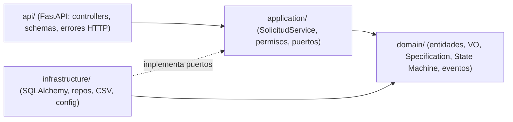
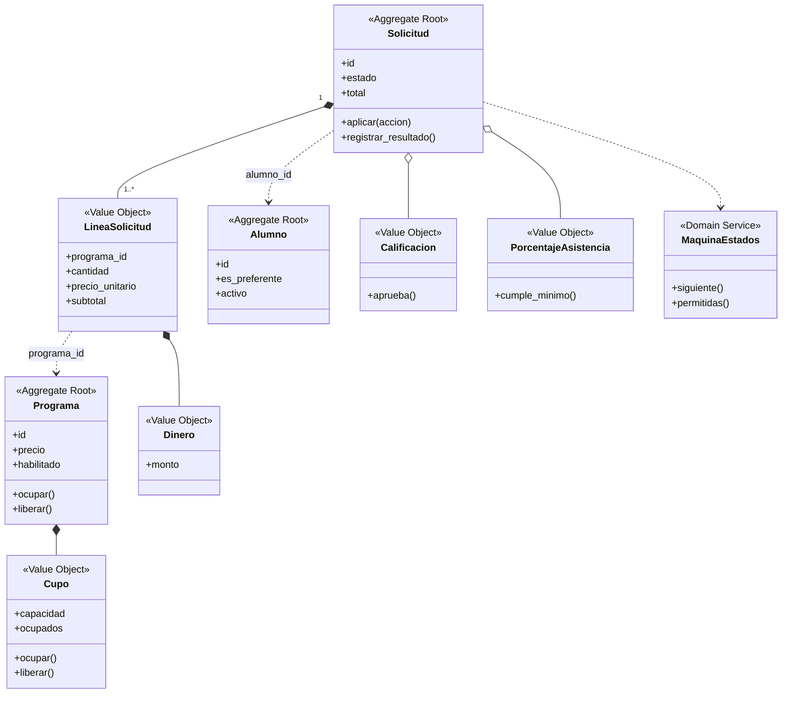
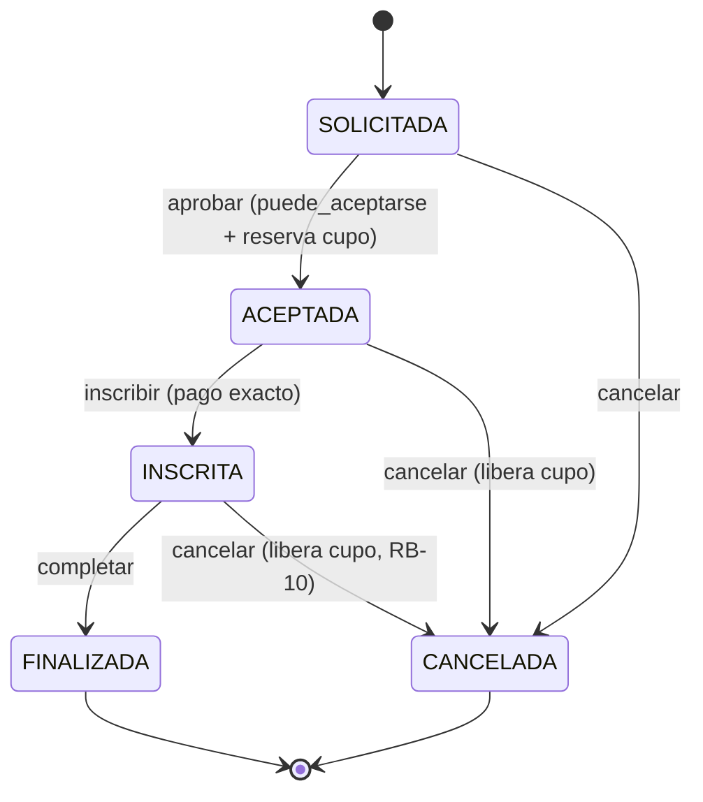
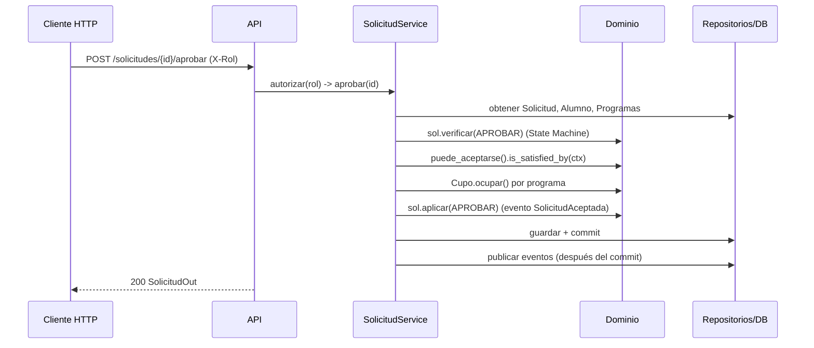

# Arquitectura y decisiones técnicas

## 1. Capas (carpeta `src/`)

Regla de dependencia: `domain` no importa nada de las otras capas; `application` solo conoce `domain` y los **puertos** (`puertos.py`); `infrastructure` y `api` dependen hacia adentro.

## 2. Modelo de dominio implementado (DDD)

Los Aggregates se relacionan **solo por identificador** (ADR-002). El diseño completo de U3 (7 Aggregates, 38 clases) sigue siendo el modelo de referencia; esta es la porción implementada en el PIA.

## 3. State Machine

## 4. Secuencia: inscribir y aprobar

## 5. Patrones y justificación
| Patrón | Dónde | Por qué |
|---|---|---|
| Domain Model + Service Layer | `domain/`, `application/servicios.py` | ADR-001: reglas con muchas excepciones (RB-01..RB-14) |
| Aggregate / Value Object | `Solicitud`, `Cupo`, `Dinero`, `Calificacion` | Invariantes protegidas y valores inmutables con validación propia |
| **Specification** | `especificaciones.py` | Las reglas del negocio cambian y se combinan (AND/OR/NOT); cada una se prueba aislada y explica por qué falla |
| **State Machine** | `estados.py` | `estado` como texto suelto permitía transiciones inválidas; la tabla las centraliza |
| Domain Events | `eventos.py`, `PublicadorSQL` | Trazabilidad (PA-03) y desacoplar efectos; se publican tras el commit |
| Repository + puertos | `puertos.py`, `repositorio_sql.py`, `memoria.py` | Dominio sin SQL; pruebas rápidas con memoria |
| Unit of Work | `UnidadDeTrabajoSQL` | Un caso de uso = una transacción |

## 6. SOLID demostrable
| Principio | Evidencia en el código |
|---|---|
| **S** Responsabilidad única | `Cupo` solo gestiona lugares; `permisos.py` solo permisos; cada Specification evalúa una condición |
| **O** Abierto/cerrado | Una regla nueva = una clase `Specification` nueva y se compone con `&`, `\|`, `~` sin tocar las existentes |
| **L** Sustitución de Liskov | `SolicitudRepoMemoria` y `SolicitudRepoSQL` son intercambiables: el mismo `SolicitudService` pasa las mismas pruebas con ambos (`tests/unit/test_servicio.py` vs `tests/integration/test_repositorio_sql.py`) |
| **I** Segregación de interfaces | `puertos.py`: un Protocol pequeño por repositorio, más `Publicador` y `UnidadDeTrabajo` |
| **D** Inversión de dependencias | `SolicitudService` recibe los puertos por constructor; `api/main.py` es el único lugar que conoce las clases SQL |

## 7. ADRs
Los ADR-001 a ADR-010 de la Unidad 3 siguen vigentes. **Copien aquí los archivos de la U3** (`docs/architecture/ADR-001…010`) y los diagramas UML originales (`docs/architecture/diagramas_u3/`).

| ADR | Título | Estado |
|---|---|---|
| ADR-001 | Domain Model con Service Layer | Vigente (U3) |
| ADR-002 | Aggregates pequeños relacionados por identificador | Vigente (U3) |
| ADR-003 | Umbrales de certificación dentro de Value Objects | Vigente (U3), implementado |
| ADR-004 | Historial de cambios de grupo e instructor como entidades | Vigente (U3), pendiente de implementar |
| ADR-005 | Permisos por rol en el Service Layer | Vigente (U3), implementado (`permisos.py`) |
| ADR-006 | Límites transaccionales y concurrencia optimista sobre Grupo | Vigente (U3); transacciones implementadas, versionado optimista pendiente |
| ADR-007 | Domain Events tras confirmar la transacción | Vigente (U3), implementado |
| ADR-008 | Consultas y reportes de solo lectura directo a repositorios | Vigente (U3) |
| ADR-009 | Domain Service PoliticaInscripcion | Vigente (U3), cubierto por `puede_procesarse` |
| ADR-010 | Precio fijado al inscribirse y estados explícitos como VO | Vigente (U3), implementado |
| [ADR-011](ADR-011-state-machine.md) | State Machine explícita para la Solicitud | **Nuevo (PIA)** |
| [ADR-012](ADR-012-specification.md) | Patrón Specification para reglas de negocio | **Nuevo (PIA)** |
| [ADR-013](ADR-013-api-persistencia-despliegue.md) | FastAPI + SQLAlchemy + PostgreSQL + Docker + Render | **Nuevo (PIA)** |
